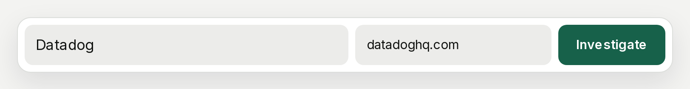
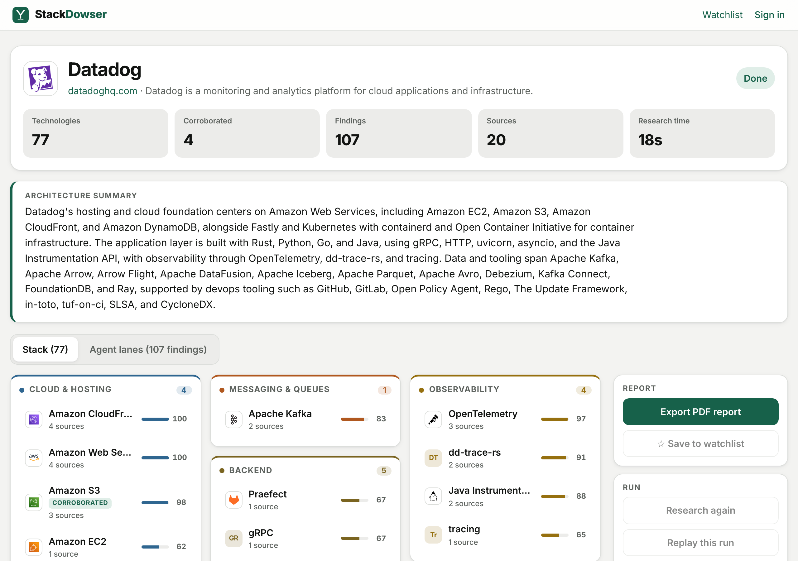
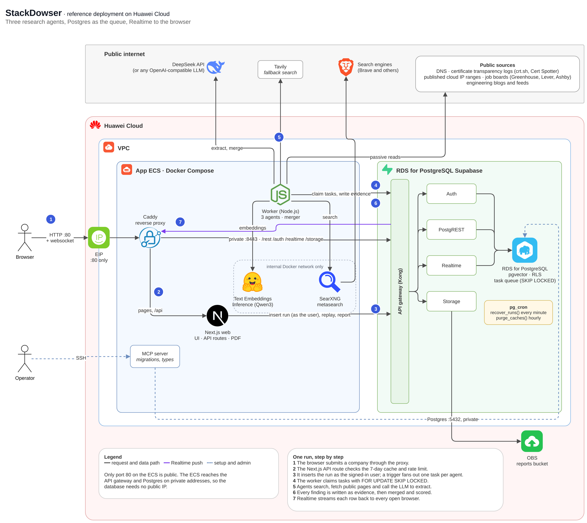

English | [简体中文](README.zh-CN.md)

# RDS Supabase Company Tech Research (StackDowser)

A full-stack AI agent application built on **Huawei Cloud RDS for PostgreSQL with the
Supabase application**. You enter a company name. Three agents then read public sources,
such as DNS records, job boards and engineering blogs, and work out which technologies the
company uses. Each technology comes with the quote and the link it was found in. A run
takes 20 to 60 seconds, and you watch the results arrive live.

The demo is a real workload rather than a feature checklist: one Next.js app and one
Node.js worker use Auth, the REST API, RLS, Postgres functions, Realtime, pgvector,
pg_cron and Storage through one RDS Supabase application.





See the [demo video](docs/demo/) (49 seconds).

## Features

| Supabase feature   | How the app uses it                                                                                                             | Notes for RDS                                                                                               |
| ------------------ | ------------------------------------------------------------------------------------------------------------------------------- | ----------------------------------------------------------------------------------------------------------- |
| Auth               | Email and password sign-in. Runs are inserted with the user's own JWT.                                                          | Works.                                                                                                      |
| REST API and RLS   | Research is readable by everyone, a watchlist only by its owner, and a user can only insert runs as themselves.                 | Works. Tables need explicit grants to `service_role` (`0013`); reload the schema cache after DDL (see FAQ). |
| Postgres functions | `claim_task()` and `finish_task()` make Postgres the task queue (`FOR UPDATE SKIP LOCKED`); `similar_companies()` ranks stacks. | Works. Functions that use pgvector are `security definer` (`0015`).                                         |
| Realtime           | `postgres_changes` on `evidence`, `agent_tasks` and `research_runs` streams every finding to every open browser.                | Works, through the proxy on the ECS.                                                                        |
| pgvector           | An HNSW index on stack embeddings for "similar companies", plus name matching against the technology dictionary.                | Works, with types written as `extensions.vector`.                                                           |
| pg_cron            | `recover_runs()` restarts stuck runs every minute; `purge_caches()` clears old cache rows every hour.                           | Works once `cron.use_background_workers` is `on` (see Quick start).                                         |
| Storage            | PDF reports are saved to a private `reports` bucket (backed by OBS) and shared by a signed link that is valid for 7 days.       | Works.                                                                                                      |
| Supabase MCP       | Every migration, advisor check and the generated TypeScript types went through the MCP server from Huawei's guide.              | Works; the guide's config template needs two small fixes ([deploy notes](docs/deploy-huawei-cloud.md)).     |

## Architecture



- **One public port.** Only port 80 on the ECS is open. Caddy serves the app and passes
  Supabase traffic (`/rest`, `/auth`, `/realtime`, `/storage`) to the API gateway over the
  private network. The gateway and the database have no public IP.
- **Postgres is the job queue.** Each run creates one task per agent. Workers pick tasks
  with `FOR UPDATE SKIP LOCKED`, so two workers never take the same one. When the last
  task finishes, the run moves on to the merge step.
- **Internal services stay internal.** SearXNG (search) and Text Embeddings Inference
  (embeddings) run only on the Docker network, with Tavily as the search fallback. The LLM
  can be any OpenAI-compatible API; the reference deployment uses DeepSeek.

## How a run works

| Agent            | Reads                                                                                                                                                           | Finds                                                                                                  |
| ---------------- | --------------------------------------------------------------------------------------------------------------------------------------------------------------- | ------------------------------------------------------------------------------------------------------ |
| Web Footprint    | DNS (MX, TXT, NS, CNAME, A), certificate transparency logs, published cloud IP ranges, the homepage                                                             | Hosting and cloud per host, CDN and WAF, email provider, SaaS domain verifications, frontend framework |
| Job Postings     | Public Greenhouse, Lever and Ashby boards, the careers page, and web search at the same time (results that robots.txt disallows, such as LinkedIn, are dropped) | Languages, frameworks, databases and infrastructure in job requirements                                |
| Engineering Blog | The blog's RSS/Atom feed or sitemap, then web search                                                                                                            | What runs in production, what was migrated to and away from                                            |

- **Agents are fixed pipelines**, not tool-calling loops: probe, search, fetch, filter,
  extract, with the LLM called at fixed steps. Each has a budget of 60 seconds, 5 searches,
  12 page reads and 8 LLM calls.
- **Every extraction is checked verbatim.** The quoted snippet has to appear in the fetched
  page, or the finding is dropped.
- **A merger** maps each name to the technology dictionary: an alias match, else an
  embedding within 0.9 cosine similarity, else the LLM proposes a new entry. It drops the
  company's own products and works out whether each technology is in use, being hired
  for, or migrated away from.
- **Replays** re-insert a finished run's evidence with its original timing, so Realtime can
  be shown without hitting the network again.

## Prerequisites

- An RDS for PostgreSQL instance with the Supabase application enabled. See
  [Introduction to RDS Supabase](https://support.huaweicloud.com/usermanual-rds-pg/rds_supabase_01.html).
- An ECS in the same VPC with about 4 vCPU and 8 GB of RAM (the embedding model alone takes
  2.5 GB), Docker with Docker Compose, and outbound internet access (an EIP or a NAT
  gateway) for search, page fetches and the LLM.
- An API key for an OpenAI-compatible LLM, for example DeepSeek.
- Optional: a [Tavily](https://tavily.com) API key as the fallback search provider.

Unlike the frontend-only demos in this repository, StackDowser has a backend worker, so it
runs on a server rather than with `npm run dev`.

## Quick start

### 1. Prepare the RDS Supabase application

In the RDS console, change these parameters and restart the instance:

- add `pg_cron` to `shared_preload_libraries`;
- set `cron.database_name` to `supabase_db`;
- set `cron.use_background_workers` to `on`. Without it pg_cron connects over TCP without a
  password, and every job fails with "connection failed".

### 2. Initialize the database

Either way creates the same schema:

- **SQL editor:** run [`sql/init.sql`](sql/init.sql) once. It contains every migration in
  order.
- **Supabase MCP server:** apply each file in `supabase/migrations/` with `apply_migration`,
  in numeric order. The first call needs the `supabase_migrations.schema_migrations` table;
  [docs/deploy-huawei-cloud.md](docs/deploy-huawei-cloud.md) has the statement and the rest
  of the MCP setup.

Then reload the API schema cache:

```sql
notify pgrst, 'reload schema';
```

### 3. Configure the environment

On the ECS, copy the code and create `.env` from the template:

```sh
cp .env.example .env
```

| Variable                                         | Value                                                                                      |
| ------------------------------------------------ | ------------------------------------------------------------------------------------------ |
| `SUPABASE_URL`                                   | The API gateway's **private** address (the ECS is in the same VPC). Browsers never use it. |
| `SUPABASE_ANON_KEY`, `SUPABASE_SERVICE_ROLE_KEY` | From the Supabase application in the RDS console.                                          |
| `PUBLIC_SITE_URL`                                | The address users open, for example `http://<ECS EIP>`. Used for links in PDF reports.     |
| `LLM_BASE_URL`, `LLM_API_KEY`, `LLM_MODEL`       | Your OpenAI-compatible LLM.                                                                |
| `SEARCH_PROVIDERS`, `TAVILY_API_KEY`             | `searxng,tavily` by default; the Tavily key is optional.                                   |

The other variables have working defaults for the Docker Compose setup.

### 4. Start the application

```sh
docker compose up -d --build
docker compose exec worker npm run embed:technologies
```

The second command embeds the technology dictionary once. Allow port 80 inbound in the
ECS security group.

### 5. Create a user

Create a user in Supabase Auth (the Studio, the Auth admin API, or `create_auth_user` in the
MCP server), then open `PUBLIC_SITE_URL` and sign in.

## Verification checklist

1. **Auth:** sign in with the user from step 5. The header shows the email address.
2. **Realtime:** enter a company name, for example `Datadog`, and click Investigate. The
   three agents' status and findings appear while they run.
3. **REST API and RLS:** open the same run in a private window without signing in. You can
   watch it, but you can't start a run.
4. **Storage:** on a finished run, export the PDF. You get a link that opens the report
   from the `reports` bucket.
5. **pgvector:** after runs for a few companies, a finished run's page lists "Similar stacks".
6. **pg_cron:** `select status, count(*) from cron.job_run_details group by status;` shows
   only `succeeded`.
7. **Replay:** replay a finished run. Its evidence streams in again with the original timing.

## FAQ

**"Could not find the table … in the schema cache" after a migration.**
Run `notify pgrst, 'reload schema';`.

**The worker gets `42501 permission denied` on its own tables.**
Tables created by the database user are not granted to `service_role` automatically.
Migration `0013` adds the grants; apply it again after you add tables.

**"operator does not exist: extensions.vector <=> extensions.vector" for signed-in users.**
Only `service_role` may use the `extensions` schema. Functions that use pgvector must be
`security definer` with a fixed `search_path`, as in `0015`.

**pg_cron jobs fail with "connection failed".**
Set `cron.use_background_workers` to `on` and restart the instance (Quick start, step 1).

**Searches return nothing.**
Search engines rate-limit single server IPs; on the reference ECS only Brave answered.
Searches are cached for 24 hours. Add a `TAVILY_API_KEY` as the fallback.

**The worker exits at startup with a SearXNG error.**
JSON output is not enabled in `searxng/settings.yml`. The worker checks this on purpose.

More operating notes are in [docs/deploy-huawei-cloud.md](docs/deploy-huawei-cloud.md).

## Project structure

```
web/                  Next.js: UI, API routes (start run, replay, delete, PDF), logos
worker/               agents, merger, search / LLM / embedding clients
packages/db/          shared zod schemas and generated database types
supabase/migrations/  numbered SQL files, applied in order
supabase/tests/       migration and task-flow tests
sql/init.sql          all migrations in one script, for the SQL editor
searxng/settings.yml  search engines for the internal SearXNG
proxy/Caddyfile       the only public entry point
docs/                 Huawei Cloud deployment notes, architecture diagram, demo video
```

## Development

```sh
npm install
npm run build --workspace @stackdowser/db
npm run lint && npm run typecheck && npm test
sh supabase/tests/run.sh      # migrations and the task flow on plain Postgres; needs Docker
sh sql/build.sh               # rebuild sql/init.sql after changing a migration
```

Unit tests cover the name normalizer, the scoring formula, the verbatim check, the CNAME
and IP-range matchers and the job board parsers, against recorded responses.

## References

- [Introduction to RDS Supabase](https://support.huaweicloud.com/usermanual-rds-pg/rds_supabase_01.html)
- [Using Supabase MCP](https://support.huaweicloud.com/intl/en-us/usermanual-rds-pg/rds_supabase_18.html)
- [AI Application Development Platform Best Practices](https://support.huaweicloud.com/bestpractice-rds-pg/rds_pg_ai_0000.html)

## Credits

Technology logos come from [Simple Icons](https://simpleicons.org) (CC0) and, for brands
Simple Icons doesn't carry, from the [Iconify "logos" set](https://github.com/gilbarbara/logos)
(CC0). The diagram uses Huawei Cloud's product icons. All logos are trademarks of their
owners and are used only to name their products.

## License

MIT, see [LICENSE](LICENSE). The logos and icons above keep their own licenses and
trademarks.
