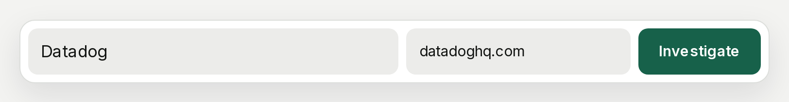
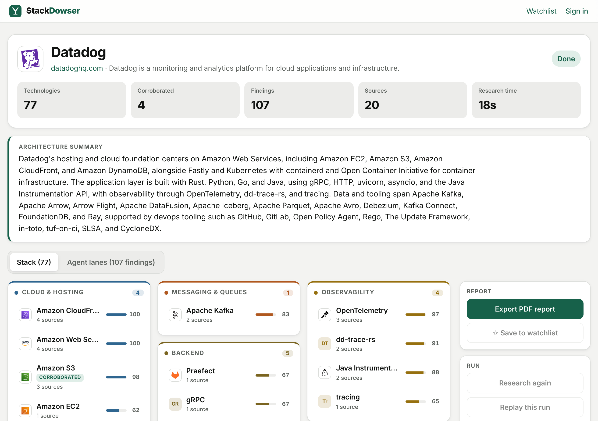
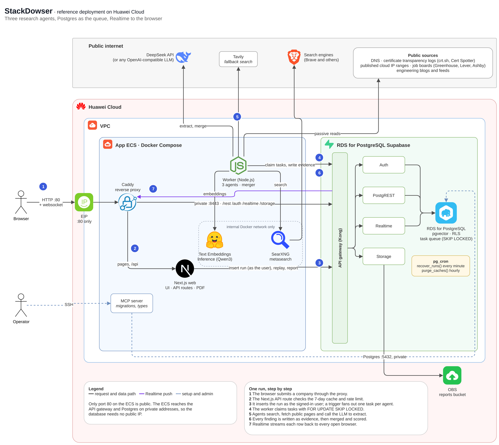

[English](README.md) | 简体中文

# RDS Supabase 企业技术栈调研（StackDowser）

基于**华为云 RDS for PostgreSQL Supabase 应用**构建的全栈 AI Agent 应用。输入公司名称后，三个
Agent 会读取公开来源（如 DNS 记录、招聘网站和技术博客），找出该公司使用的技术。每项技术都附带
发现它的原文引用和链接。一次调研需要 20 到 60 秒，结果会实时显示在页面上。

本示例是一个真实的工作负载，而不是功能清单：一个 Next.js 应用和一个 Node.js Worker 通过同一个
RDS Supabase 应用使用 Auth、REST API、RLS、Postgres 函数、Realtime、pgvector、pg_cron 和
Storage。





查看[演示视频](docs/demo/)（49 秒）。

## 功能特性

| Supabase 能力 | 应用中的用法                                                                                                                 | RDS 上的说明                                                                                      |
| ------------- | ---------------------------------------------------------------------------------------------------------------------------- | ------------------------------------------------------------------------------------------------- |
| Auth          | 邮箱和密码登录。调研任务以用户自己的 JWT 写入。                                                                              | 可用。                                                                                            |
| REST API、RLS | 所有人都能读取调研结果；关注列表只有所有者可见；用户只能以自己的身份创建调研。                                               | 可用。表需要显式授权给 `service_role`（`0013`）；DDL 之后需要重新加载 schema 缓存（见常见问题）。 |
| Postgres 函数 | `claim_task()` 和 `finish_task()` 把 Postgres 用作任务队列（`FOR UPDATE SKIP LOCKED`）；`similar_companies()` 对技术栈排序。 | 可用。使用 pgvector 的函数设为 `security definer`（`0015`）。                                     |
| Realtime      | 对 `evidence`、`agent_tasks` 和 `research_runs` 的 `postgres_changes` 把每条发现实时推送到所有打开的浏览器。                 | 可用，经由 ECS 上的代理。                                                                         |
| pgvector      | 技术栈向量的 HNSW 索引用于"相似公司"，并用于把技术名称匹配到技术词典。                                                       | 可用，类型写作 `extensions.vector`。                                                              |
| pg_cron       | `recover_runs()` 每分钟重启卡住的调研；`purge_caches()` 每小时清理旧的缓存行。                                               | 将 `cron.use_background_workers` 设为 `on` 后可用（见快速开始）。                                 |
| Storage       | PDF 报告保存在私有的 `reports` 存储桶（基于 OBS）中，通过 7 天有效的签名链接分享。                                           | 可用。                                                                                            |
| Supabase MCP  | 所有迁移、Advisor 检查和生成的 TypeScript 类型都通过华为指南中的 MCP Server 完成。                                           | 可用；指南中的配置模板需要两处小修改（见[部署说明](docs/deploy-huawei-cloud.md)）。               |

## 架构



- **只有一个公网端口。** ECS 只开放 80 端口。Caddy 提供应用页面，并通过私网把 Supabase 流量
  （`/rest`、`/auth`、`/realtime`、`/storage`）转发到 API 网关。网关和数据库都没有公网 IP。
- **Postgres 就是任务队列。** 每次调研为每个 Agent 创建一个任务。Worker 用
  `FOR UPDATE SKIP LOCKED` 领取任务，所以两个 Worker 不会领取同一个任务。最后一个任务完成后，
  调研进入合并步骤。
- **内部服务只在内部。** SearXNG（搜索）和 Text Embeddings Inference（向量化）只运行在 Docker
  网络中，Tavily 作为备用搜索。LLM 可以是任何兼容 OpenAI 的 API；参考部署使用 DeepSeek。

## 一次调研如何运行

| Agent            | 读取                                                                                                                   | 找出                                                                    |
| ---------------- | ---------------------------------------------------------------------------------------------------------------------- | ----------------------------------------------------------------------- |
| Web Footprint    | DNS（MX、TXT、NS、CNAME、A）、证书透明度日志、公开的云 IP 段、公司主页                                                 | 每个主机的托管和云厂商、CDN 和 WAF、邮件服务商、SaaS 域名验证、前端框架 |
| Job Postings     | 公开的 Greenhouse、Lever 和 Ashby 招聘页、公司招聘页，同时进行网页搜索（robots.txt 禁止的结果会被丢弃，例如 LinkedIn） | 职位要求中的编程语言、框架、数据库和基础设施                            |
| Engineering Blog | 博客的 RSS/Atom 订阅或站点地图，然后是网页搜索                                                                         | 生产环境中运行的技术，以及迁移到或迁移离开的技术                        |

- **Agent 是固定流程**，不是工具调用循环：探测、搜索、抓取、过滤、提取，在固定步骤调用 LLM。
  每个 Agent 的预算为 60 秒、5 次搜索、12 次页面读取和 8 次 LLM 调用。
- **每次提取都逐字校验。** 引用的片段必须出现在抓取的页面中，否则丢弃该发现。
- **合并器**把每个名称映射到技术词典：先按别名匹配，否则按余弦相似度 0.9 以内的向量匹配，否则由
  LLM 提议新条目。它会去掉公司自己的产品，并判断每项技术是在使用中、正在招聘，还是已经迁移离开。
- **回放**会按原始时间重新写入一次完成的调研的证据，这样不用再次访问网络也能演示 Realtime。

## 前提条件

- 已开通 Supabase 应用的 RDS for PostgreSQL 实例。参见
  [RDS Supabase 简介](https://support.huaweicloud.com/usermanual-rds-pg/rds_supabase_01.html)。
- 同一 VPC 中的一台 ECS：约 4 vCPU、8 GB 内存（仅向量模型就占用 2.5 GB），安装 Docker 和
  Docker Compose，并能访问公网（EIP 或 NAT 网关），用于搜索、抓取页面和调用 LLM。
- 一个兼容 OpenAI 的 LLM API Key，例如 DeepSeek。
- 可选：[Tavily](https://tavily.com) API Key，作为备用搜索。

与本仓库中纯前端的示例不同，StackDowser 有后端 Worker，所以需要运行在服务器上，而不是用
`npm run dev` 运行。

## 快速开始

### 1. 准备 RDS Supabase 应用

在 RDS 控制台修改以下参数，然后重启实例：

- 在 `shared_preload_libraries` 中加入 `pg_cron`；
- 将 `cron.database_name` 设为 `supabase_db`；
- 将 `cron.use_background_workers` 设为 `on`。否则 pg_cron 会通过 TCP 无密码连接，所有任务都会
  以 "connection failed" 失败。

### 2. 初始化数据库

以下两种方式会创建相同的 schema：

- **SQL 编辑器：** 执行一次 [`sql/init.sql`](sql/init.sql)。它按顺序包含所有迁移。
- **Supabase MCP Server：** 按编号顺序用 `apply_migration` 执行 `supabase/migrations/` 中的每个
  文件。第一次调用需要 `supabase_migrations.schema_migrations` 表；建表语句和 MCP 的其他配置见
  [docs/deploy-huawei-cloud.md](docs/deploy-huawei-cloud.md)。

然后重新加载 API 的 schema 缓存：

```sql
notify pgrst, 'reload schema';
```

### 3. 配置环境变量

在 ECS 上复制代码，并从模板创建 `.env`：

```sh
cp .env.example .env
```

| 变量                                             | 取值                                                             |
| ------------------------------------------------ | ---------------------------------------------------------------- |
| `SUPABASE_URL`                                   | API 网关的**私网**地址（ECS 在同一 VPC 中）。浏览器不会使用它。  |
| `SUPABASE_ANON_KEY`、`SUPABASE_SERVICE_ROLE_KEY` | 从 RDS 控制台的 Supabase 应用中获取。                            |
| `PUBLIC_SITE_URL`                                | 用户访问的地址，例如 `http://<ECS EIP>`。用于 PDF 报告中的链接。 |
| `LLM_BASE_URL`、`LLM_API_KEY`、`LLM_MODEL`       | 你的兼容 OpenAI 的 LLM。                                         |
| `SEARCH_PROVIDERS`、`TAVILY_API_KEY`             | 默认 `searxng,tavily`；Tavily Key 可选。                         |

其他变量在 Docker Compose 部署下有可用的默认值。

### 4. 启动应用

```sh
docker compose up -d --build
docker compose exec worker npm run embed:technologies
```

第二条命令对技术词典做一次向量化。在 ECS 安全组中放通 80 端口入方向。

### 5. 创建用户

在 Supabase Auth 中创建用户（通过 Studio、Auth 管理 API 或 MCP Server 的 `create_auth_user`），
然后打开 `PUBLIC_SITE_URL` 并登录。

## 端到端验证清单

1. **Auth：** 用第 5 步的用户登录。页面顶部显示邮箱地址。
2. **Realtime：** 输入公司名称（例如 `Datadog`）并点击 Investigate。三个 Agent 运行时，状态和
   发现会实时出现。
3. **REST API 和 RLS：** 在未登录的无痕窗口中打开同一次调研。可以查看，但不能发起调研。
4. **Storage：** 在一次完成的调研中导出 PDF。会得到一个从 `reports` 存储桶打开报告的链接。
5. **pgvector：** 对几家公司完成调研后，调研页面会显示 "Similar stacks"（相似技术栈）。
6. **pg_cron：** `select status, count(*) from cron.job_run_details group by status;` 只显示
   `succeeded`。
7. **回放：** 回放一次完成的调研。证据会按原始时间再次实时出现。

## 常见问题

**迁移后报 "Could not find the table … in the schema cache"。**
执行 `notify pgrst, 'reload schema';`。

**Worker 访问自己的表时报 `42501 permission denied`。**
数据库用户创建的表不会自动授权给 `service_role`。迁移 `0013` 会添加授权；新增表后需要再次执行。

**已登录用户报 "operator does not exist: extensions.vector <=> extensions.vector"。**
只有 `service_role` 可以使用 `extensions` schema。使用 pgvector 的函数必须是
`security definer` 并固定 `search_path`，参见 `0015`。

**pg_cron 任务报 "connection failed"。**
将 `cron.use_background_workers` 设为 `on` 并重启实例（快速开始第 1 步）。

**搜索没有结果。**
搜索引擎会限制单个服务器 IP；在参考 ECS 上只有 Brave 有响应。搜索结果缓存 24 小时。可以配置
`TAVILY_API_KEY` 作为备用。

**Worker 启动时因 SearXNG 错误退出。**
`searxng/settings.yml` 中没有开启 JSON 输出。Worker 会特意检查这一点。

更多运维说明见 [docs/deploy-huawei-cloud.md](docs/deploy-huawei-cloud.md)（英文）。

## 项目结构

```
web/                  Next.js：界面、API 路由（发起调研、回放、删除、PDF）、Logo
worker/               Agent、合并器、搜索 / LLM / 向量化客户端
packages/db/          共享的 zod schema 和生成的数据库类型
supabase/migrations/  按编号顺序执行的 SQL 文件
supabase/tests/       迁移和任务流程测试
sql/init.sql          合并为一个脚本的所有迁移，用于 SQL 编辑器
searxng/settings.yml  内部 SearXNG 的搜索引擎配置
proxy/Caddyfile       唯一的公网入口
docs/                 华为云部署说明、架构图、演示视频
```

## 开发

```sh
npm install
npm run build --workspace @stackdowser/db
npm run lint && npm run typecheck && npm test
sh supabase/tests/run.sh      # 在普通 Postgres 上测试迁移和任务流程；需要 Docker
sh sql/build.sh               # 修改迁移后重新生成 sql/init.sql
```

## 参考

- [RDS Supabase 简介](https://support.huaweicloud.com/usermanual-rds-pg/rds_supabase_01.html)
- [使用 Supabase MCP](https://support.huaweicloud.com/usermanual-rds-pg/rds_supabase_18.html)
- [AI 应用开发平台最佳实践](https://support.huaweicloud.com/bestpractice-rds-pg/rds_pg_ai_0000.html)

## 致谢

技术 Logo 来自 [Simple Icons](https://simpleicons.org)（CC0），Simple Icons 未收录的品牌来自
[Iconify "logos" 图标集](https://github.com/gilbarbara/logos)（CC0）。架构图使用华为云产品图标。
所有 Logo 均为其所有者的商标，仅用于指代其产品。

## 许可证

MIT，见 [LICENSE](LICENSE)。上述 Logo 和图标保留其各自的许可证和商标。
